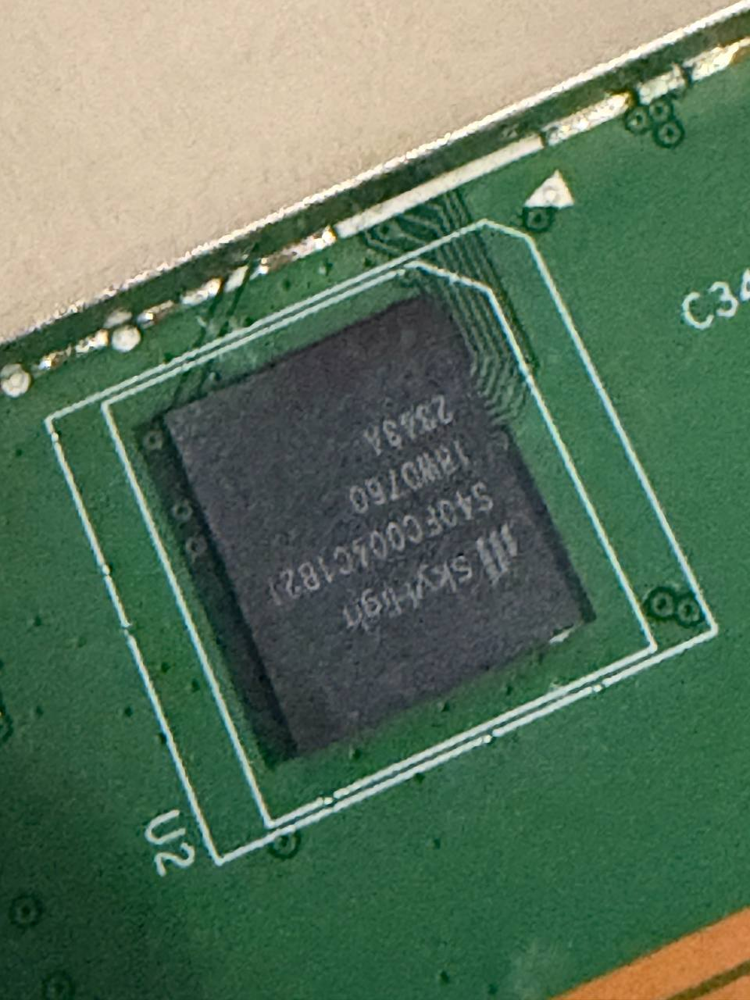
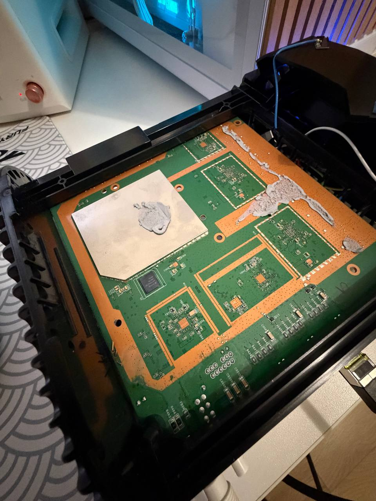
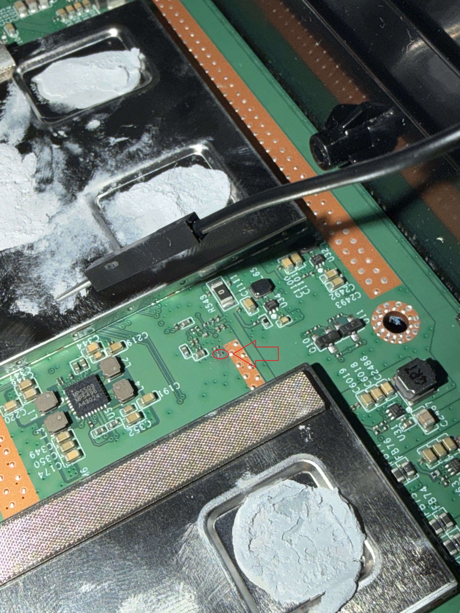
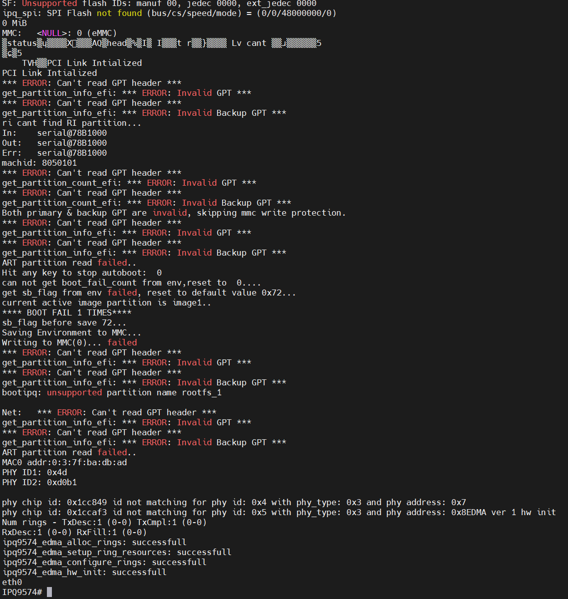

# Nokia Beacon 10: pre-authentication arbitrary write in `bootipq` — and why secure boot still holds

Research on the Qualcomm IPQ9574-based **Nokia Beacon 10** (T-Mobile, FCC 2AD2RBEACOM10),
firmware `2402b.04.09.A17` family (OpenWrt 19.07-SNAPSHOT r123-33e9ef7bb base, vendor build
Sep 2024, U-Boot 2016.01 QSDK, ARM32).

**TL;DR** The vendor `bootipq` boot command parses the attacker-controlled `0:HLOS`
container (a custom ELF32 wrapper holding a FIT image) and loads the **entire partition
(10 MiB) to an attacker-controlled address before the image signature is verified**.
This is a genuine pre-authentication arbitrary-write primitive — but on this product the
Qualcomm XPU places the running bootloader's code and the C stack inside a protected region
that a fixed-size 10 MiB write can never reach without tripping, so the primitive does **not**
escalate to code execution. Secure boot holds. This document describes the full path to the
primitive, the proof-of-concept experiments, and the escalation analysis.

Everything here was performed on devices owned by the author of this repository.
Related: [Beacon10-Getshell](https://github.com/akorshun/Beacon10-Getshell) (root shell on
the stock firmware, used as the entry point), and the
[OpenWrt support PR #26129](https://github.com/openwrt/openwrt/pull/26129) where parts of
this were first discussed.

---

## 1. Entry point: root shell on the stock firmware

The stock web UI is vulnerable to a race-condition command injection
(`troubleshooting_web_app.cgi?ping` racing `usb_web_app.cgi?import` — suspected
CVE-2025-9974), which yields a root shell without UART. Tooling and details:
[Beacon10-Getshell](https://github.com/akorshun/Beacon10-Getshell). From that shell the
eMMC is fully writable (`dd`), which is how every experiment below was delivered.

## 2. The secure boot chain

```
PBL (fuse-root-of-trust) -> SBL1 -> QSEE/TME-L -> APPSBL (U-Boot 2016.01) -> HLOS
```

* SBL1 authenticates every stage it loads (`Auth Metadata` + `Segments hash check` lines in
  the boot log, including `APPSBL`) — **replacing or patching U-Boot on flash is not possible**.
* SBL1 reports `S - Secure Boot: On`; the live U-Boot command
  `is_sec_boot_enabled` answers **"secure boot fuse is enabled"**.
* The vendor `bootipq` command loads `0:HLOS` and extends authentication to the kernel
  through `do_boot_signedimg()` (`cmd_bootqca.c:937`), which delegates to QSEE. An unsigned
  image is rejected with `Kernel image authentication failed` followed by a `BUG!` reset.
* Manual `bootm <addr>#<config>` **bypasses that check** (it never calls
  `do_boot_signedimg`) — which is why the OpenWrt install procedure boots OpenWrt over
  UART with `tftpboot` + `bootm` on every power cycle.
* The vendor autoboot **ignores `bootcmd`** entirely (it runs the `bootipq` slot logic
  directly), so environment-based boot changes do not survive without UART.

## 3. The `0:HLOS` container format (reverse-engineered)

`0:HLOS` (p24, 10 MiB) is a fake-ELF32 container — a real ELF32 header
(`e_phoff=0x34`, 3 program headers, `e_phentsize=0x20`) wrapping a FIT image:

| phdr | type | file offset | vaddr | filesz | content |
|---|---|---|---|---|---|
| 0 | PT_NULL | 0x0 | 0x0 | 0xb4 | header/placeholder |
| 1 | PT_NULL | 0x1000 | 0x0 | 0xe48 | metadata blob (unused by bootipq) |
| 2 | PT_LOAD | 0x2000 | 0x44000000 | 0x391ea4 | **the FIT image** |

`bootipq` flow (verified by console capture and static analysis of the ARM32 payload,
which is loaded at VA 0x4a400000 from file offset 0x10000):

1. Reads the first 148 eMMC blocks (0x12800 bytes) into a heap buffer.
2. A locator function (VA `0x4a4039c4`) validates only the ELF magic and `e_type == 2`,
   then scans **exactly 3 program headers** (a constant `+0x60` bound) and returns the
   **first `PT_LOAD`'s `{p_offset, p_paddr, p_filesz}` with zero validation** of any field.
3. The caller issues `mmc read <dest> <part-start> 20480` — **the entire 10 MiB partition** —
   where `<dest>` is derived from the attacker-controlled `p_vaddr`/`p_offset`.
4. **Only then** `do_boot_signedimg()` authenticates the loaded image (QSEE SCM call).
5. On success the FIT at `loadaddr` is parsed (the FIT config name is derived from the
   device partnumber: `config@3TN00201AB`) and booted.

### The vulnerability

Step 3 writes **10 MiB of fully attacker-controlled bytes (the whole partition content) to
an attacker-chosen address, before any signature check**. Neither `p_vaddr` nor `p_offset`
nor `p_filesz` is validated against the partition size or a load-address whitelist.

## 4. Proof of concept

Three containers differing only in `phdr2.p_vaddr` (all other bytes identical), flashed to
`0:HLOS` from the stock root shell, then `bootipq`:

| probe | `p_vaddr` | window | result |
|---|---|---|---|
| A (control) | 0x44000000 | [0x44000000, 0x4e000000) | clean `Kernel image authentication failed` + `BUG!` + reset (the normal path) |
| B | **0x4a400000** | [0x49ffe000, 0x59ffe000) | **hard reset mid `MMC read` with no authentication message** — the write crossed the live U-Boot/protected region and the board died before the signature check could run |
| D1 | 0x49a42000 | [0x49a40000, 0x4a400000) | read **completes** — proves the region below 0x4a400000 is DMA-writable |

Raw console captures: [`logs/probe_a.bootipq.out`](logs/probe_a_ctl.bin.bootipq.out),
[`logs/probe_b.bootipq.out`](logs/probe_b.bootipq.out), [`logs/probe_d1.out`](logs/probe_d1.out).
Probe builder: [`tools/make_test_container.py`](tools/make_test_container.py).

## 5. Escalation analysis — why this does not break secure boot

To turn the write into code execution one would target either the running bootloader's
**code** or its **C stack** (return-address overwrite):

* U-Boot code+data lives at VA/PA `0x4a400000`–`0x4a4e6f4`
  (`relocaddr = 0x4a400000`, `reloc off = 0`, MMU identity-mapped for DRAM — verified by
  dumping the ARM32 page tables at `TLB addr 0x4a510000`).
* The C stack lives at `0x4a27fxxx` (`sp start = 0x4a27fa80`), i.e. only **~1.6 MiB below**
  the start of the code region.

The blast window is fixed at exactly 10 MiB. Geometry:

* To cover the code region the window must start at `p_vaddr - p_offset ≤ 0x4a400000` and
  therefore always extends ≥ 10 MiB upward, crossing **0x4a400000 itself** — the first byte
  of the XPU-protected bootloader region.
* To cover the stack the window must start at `≥ 0x4a27fa90 - 10 MiB = 0x4027fa90`; any such
  window ends at `≥ 0x4a27fa90`, and every window ending at or beyond `0x4a27fa90` that is
  wide enough to reach downward past the code... cannot: a 10 MiB window covering the stack
  necessarily extends ~8.4 MiB past the stack top, across the 0x4a400000 boundary.
* Empirically: probe B (window crossing 0x4a400000) hard-resets mid-read — the XPU denies
  the DMA write to the bootloader region — while probe D1 (window ending exactly at
  0x4a400000) completes. The boundary sits precisely between the writable world and
  everything worth overwriting.

With the code and stack both unreachable, the remaining writable regions
(free DRAM below `0x4a100000`, and the `0x4a100000`–`0x4a400000` scratch area) contain
nothing that redirects execution. An attempted full exploit
([`tools/build_exploit.py`](tools/build_exploit.py) — memory-image container with the
U-Boot code re-written byte-exact, `do_boot_signedimg` patched to `mov r0,#0; bx lr`,
a shellcode calling `do_bootm` on an embedded OpenWrt FIT, and a stack spray) is included
for documentation; it is **not** expected to work and was never run past the geometry
analysis, for the reasons above.

## 6. Impact and recommendations

* **What an attacker gets**: a pre-authentication (in the secure-boot sense) 10 MiB DMA
  write to an arbitrary address below `0x4a400000`, plus the ability to make `bootipq`
  parse arbitrary FIT structures from memory (the FIT parse itself also processes
  attacker data before any trust decision). On this product neither leads to code
  execution because of the XPU placement.
* **What it means for the design**: the vendor's secure boot survives this attack class —
  but only thanks to XPU region placement, not because the parser is safe. On a SoC or
  board revision where the bootloader is loaded elsewhere (or the XPU is configured
  differently), the same primitive would be lethal.
* **Recommendations to the vendor**:
  1. Validate `p_offset`, `p_vaddr`, `p_filesz` in the ELF/PT_LOAD locator against the
     partition bounds and a load-address whitelist.
  2. Read only `p_filesz` bytes from `p_offset`, not the whole partition.
  3. Keep the XPU protection of the loaded bootloader region (it is the only thing that
     contained this bug).

## 7. Artifacts

```
tools/make_test_container.py   probe container builder
tools/probe_via_uboot.py       probe driver (TFTP + mmc write + bootipq)
tools/probe_cycle2.py          probe driver (stock dd + bootipq state machine)
tools/build_exploit.py         attempted escalation (documented, not viable)
logs/probe_a_ctl.bin.bootipq.out   control probe console capture
logs/probe_b.bootipq.out           crossing-probe console capture (the proof)
logs/probe_d1.out                  boundary probe console capture
```

## 7b. Attempted bypass via test-key re-signing (2026-11-09 — failed, and why)

Because the memory-failure path is closed by XPU, the remaining idea was to **legitimately
sign our own image**: if the fused root of trust were a *publicly known* Qualcomm test key,
the vendor `sectools` tool could re-sign an arbitrary (OpenWrt) `0:HLOS` container and
`bootipq` would authenticate it. This was tested on hardware and conclusively ruled out.

**What the fuse actually pins.** The secboot metadata (seg1) of the stock `0:HLOS` carries a
two-cert chain: attest cert → self-signed root **`CN=TESTCERT ROOT CA, OU=General TestCert
rootca, O=QTI`** (RSA-2048, e=65537, created 2022-11-16, 10-year validity). The QFPROM
`PK_HASH_0` region (corrected-address view readable from U-Boot `md` at `0x000a02e0`,
mirrored at `0x000a42e0`/`0x000a60c8`) holds exactly **48 bytes = SHA-384 of the TESTCERT
ROOT CA certificate** (`e9026b5677…fecd7761`) — a single 6×64-bit row region, i.e. **no
second root-cert-hash slot exists on this platform** for a multi-root trick. The
`OEM_SECURE_BOOT1` control row selects between `PK_HASH_IN_FUSE` (this hash) and a PBL ROM
table; the TESTCERT hash appears **nowhere in any on-flash bootloader image** (p1–p24
searched, including bit-rotations), so the fuse path is the only one in use.

**Hardware test of sectools TEST signing.** A stock-format `0:HLOS` container rebuilt with
an OpenWrt FIT (`config@3TN00201AB`) was signed with `sectools v1.43` (aarch64) in
`--signing-mode TEST` and flashed to the active slot (`0:HLOS_1`, p25; rootfs to p27).
`bootipq` read and parsed the container, then QSEE rejected it:

```
MMC read: dev # 0, block # 70178, count 20480 ... 20480 blocks read: OK
Kernel image authentication failed
BUG: failure at board/qca/arm/common/cmd_bootqca.c:937/do_boot_signedimg()!
BUG!
resetting
```

Certificate comparison explains it: sectools v1.43's built-in TEST PKI is
**`SECTOOLS SECP384R1 CURVE TEST ROOT` (2016, EC P-384)** — a different root from the
device's 2022 RSA PKI. The same negative result holds for the **2025-era sectools** build
(qti_signing_server 25.1.0): its embedded test-signing assets cover 28 algorithm families
(RSA-2048/4096 × e=3/257/65537 × SHA-256/384 × PKCS/PSS, EC P-256/P-384, Dilithium3,
ML-DSA-65/87) with root0–root15 each, and **none of the ~120 built-in root certificates
matches the device's TESTCERT ROOT CA**. The 2022 PKI is vendor-generated ("General
TestCert rootca" is a sectools-generated placeholder identity); its private key exists only
at the vendor.

**Other dead ends checked and closed:**

* U-Boot env `secboot` / `sb_flag` — manufacturing flags (fuse-blow flow and A/B slot
  state respectively), not authentication bypasses; `do_boot_signedimg` consults the fuse,
  not these variables.
* `fuseipq <addr>` (U-Boot) — blows a sectools-generated `sec.dat` fuse image; it cannot
  help: the platform has no free root-hash row to add a second root of our own.
* Reading QFPROM from Linux (`/sys/bus/nvmem/qfprom0`) is blocked (returns empty); the
  corrected-address alias is readable from U-Boot `md`, but raw-row addresses fault.

**Conclusion.** The root of trust is a vendor-only private key. With public tooling, secure
boot on this device cannot be broken: neither by memory corruption (§5) nor by re-signing.
The only software route to running OpenWrt remains the U-Boot `bootm` path over UART
(manual or a UART auto-typing dongle), since `bootm` itself never calls
`do_boot_signedimg`.

## 7c. Fuzzing the QSEE kernel-auth parser — a pre-authentication hang (2026-11-10)

Since QSEE parses the container *before* any signature verdict, the kernel-auth input
format itself was fuzzed: **76 mutations** of the `0:HLOS` container (secboot metadata
header fields, metadata version, zeroed signature/cert chain, ELF header fields,
`e_phnum`/`e_phoff`/`e_phentsize`, and the three program-header descriptors) were booted
through `bootipq` one per cycle, writing each variant into the primary HLOS slot from the
U-Boot prompt (`mmc read` from a scratch partition + `mmc write`), and classifying the
serial outcome. Full result table:
[`logs/qsee_fuzz_results.json`](logs/qsee_fuzz_results.json); serial evidence:
[`logs/qsee_kernelauth_fuzz_evidence.log`](logs/qsee_kernelauth_fuzz_evidence.log).

**Result: 74 clean rejects, 0 bypasses, 2 hard hangs.** The two hangs are mutations of the
metadata segment descriptor (phdr1) — the descriptor QSEE must use to locate the secboot
metadata inside the image:

| phdr1 mutation | outcome |
|---|---|
| `p_offset = 0xffffffff` | **hard hang**: after the whole-partition read there is no `Kernel image authentication failed`, no `BUG!`, no `resetting`, no watchdog reset — UART goes permanently silent, network dead, board unrecoverable until power cycle |
| `p_filesz = 0xffffffff` | identical hard hang |

A clean reject, for comparison, always prints `Kernel image authentication failed` →
`BUG: failure at board/qca/arm/common/cmd_bootqca.c:937` → `resetting` within seconds.
The hang therefore happens *inside* the SCM kernel-auth call, in the secure world, while
QSEE is locating/reading the metadata through the attacker-controlled segment descriptor —
before any signature verdict. Impact: **a pre-authentication denial-of-service of the
secure boot chain**: anyone who can write `0:HLOS` (e.g. the web-UI race of
[Beacon10-Getshell](https://github.com/akorshun/Beacon10-Getshell)) bricks the boot of the
device until a power cycle, with the board dying in a state that produces no crash dump.
A controlled crash of the secure-world parser is also the natural starting point for
escalation research (memory-corruption → secure-world code execution), though no such
escalation was attempted or achieved here.

Notes on the harness, useful for reproduction:

* The vendor U-Boot exposes `secure_authenticate <sw_id> <addr> <size>` (SCM svc 1 /
  cmd 0x1f), but that is the **MBN/rootfs auth service** — it returns `-2` (`SCM_EINVAL_ARG`)
  for every sw_id 0x0–0x17 against the kernel container. The boot path uses a different
  call (`qca_scm_auth_kernel`, svc 1 / cmd **0x1e**, a single VAL argument = image base),
  which has no standalone U-Boot command — hence the bootipq-driven loop.
* The U-Boot prompt is **W^X-hardened**: the ARM L1 page tables mark the entire writable
  DRAM XN (execute-never) except the U-Boot region itself (`0x4a401c0e` vs
  `0x4a301c1e`/`0x50001c1e` descriptors), so `go`-based code execution from the prompt is
  impossible (`prefetch abort` at any writable address). A commendable hardening — and the
  reason the fuzzing had to go through real boots.
* The U-Boot CLI also has a command inactivity timeout ("Timeout waiting for command" →
  reset), and the A/B slot switch is `sh img` (bare `sh` only *shows* the state); when the
  BOOTCONFIG active slot disagrees with the `sb_flag` primary, bootipq force-boots the
  primary slot.

## 7d. The `shell`-escape authentication ("Password2") — fully mapped (2026-11-10)

The vendor integrated shell (`svcroot` login → Quagga `Beacon 10#`) hides a `shell` command
that escalates to a real uid-0 `/bin/sh` behind a `Password2:` prompt (3 failures → 300 s
lockout via `/tmp/tryLogin`, deletable by root). Following the methodology of the
[Nokia Beacon 1 write-up](https://spaceraccoon.dev/nokia-beacon-router-uart-command-injection/)
(which recovered the per-device password of the Beacon 1 from `gen_varlen_vtyshpw` +
`libsec_engine.so`), the Beacon 10 implementation was traced end-to-end:

```
vtysh "shell"  →  /sbin/sec_cli startshell <loginmode>        (the /sbin/secmulti busybox-style binary)
              →  my_getpass() prints "Password2: "
              →  SE_passwd_db_auth_ex(input, db)              (libsec_engine.so)
              →  sec_auth_pwd(input, hash): crypt() against a $5$ (SHA-256-crypt) entry
              →  on success: startshell_proc() → uid-0 /bin/sh
```

**Key finding — the authentication database is static and baked into the binary.**
`/sbin/sec_cli` carries, in plaintext (file offset `0xe10e`), the shadow line the check
runs against:

```
ONTUSER:$5$oKDRv2eE/FvWfbYb$KUZMFQhW5OmeG.Cd5FqBTCOaxo0MLmkYxw.eecp0RC9
```

`ONTUSER` is a hidden uid-0 account with `/bin/sh` (present in the in-memory passwd/group:
member of `wheel`). There is **no per-device component**: unlike the Beacon 1 (where the
vtysh password is derived from the unit serial), the Beacon 10 hash is one build-time
constant shared by every unit running this firmware image (`3TN00367LJLJ17`), regardless of
ISP. The plaintext password is the output of `gen_varlen_ontupw` (`libsec_engine.so`,
heavily obfuscated; the rodata carries the generator family tags `MERGE_EX/MGNT/WLAN/OMCI/
VTYSH/ONTUSER/BLDR` and the key name `key14`), computed by the vendor at build time from
the key-derivation chain (`keysrc0` = firmware version string, `/usr/etc/sec.key`, engine
state seeded through `SecSetInputKV`/`SecPreProcessGenHash`).

**Escate-init deep dive (follow-up).** The key-derivation pipeline was partially
reproduced: `/sbin/sec_cli` contains a hidden `sedb` command —
`sec_cli sedb -1 <keysrc1> -2 <keysrc2> [-3] [-4] [-e hashfile] [-f fwfile]` — which
derives the whole key database from `/usr/etc/sec.key` plus keysrc strings and writes it
to `/tmp/sedb.conf` (then copied to `/configs/sedb.conf`). The runtime key sources are
confirmed from `/tmp/secKeySrc.conf` written by the boot-time engine:
`keysrc0=keysrc1=keysrc2=3TN00367LJLJ17` (the firmware version string), plus a binary
external firmware key `/tmp/.ext_fwkey` (base64-wrapped, 89 bytes) produced by the
tamper-detection daemon. The engine itself runs as a service (`sec_monitor`, socket
`/tmp/lsec_socket_server`), and `SE_loadSecFile` called from an isolated process returns
the file size without populating the key table — the derived keys stay inside the
monitor's address space. Recovering the ONTUSER password therefore requires speaking the
`lsec` socket protocol (or further reversing `sec_monitor`); two 12-character strings
embedded in `sec_cli` (`nSW6wc2[uofm`, `7lo:p9UzcjrS`) are generator chain inputs and
verified **not** to be the password themselves.

Reproduction attempts on-device (a musl-compiled `dlopen` harness executed on the router,
`vtysh_re/harness.c`, built on an aarch64 CI runner) confirm `SecBlockInit` /
`SecSetInputKV` / `SE_loadConfFile` work, but full key derivation requires the complete
`SE_escate_start` chain (tamper-state verification against `/configs/cfg.signed` by the
`detect` daemon) — `SE_loadSecFile` returns error `0xa` ("no fw info") outside it, and the
generators return empty output. Recovering the plaintext therefore reduces to either
reversing the escate init chain or an offline dictionary attack against the static
`$5$` hash. The full rockyou wordlist (14.3 M candidates, 1 h 39 m, 4 ARM64 cores) was
exhausted without a hit — consistent with a 12-character generator output.

**Live-process memory analysis (negative).** Three processes were dumped via
`/proc/<pid>/mem` (all rw-p regions) and every printable string was tested against the
static hash: `sec_monitor` (the key-derivation service, 827 KB), `wifihostd` (which
imports the `gen_varlen_wlanpw` family and has `libsec_engine.so` loaded, 1.4 MB), and the
`sec_cli` child at the `Password2:` prompt. None contained the plaintext, the escate key
material, or even the `ONTUSER`/`VTYSH`/`key14` markers — confirming that
`gen_varlen_ontupw` is **never executed on the device**: the ONTUSER password was derived
once, at build time, on the vendor's key-provisioning machine. The generator inputs
(`keysrc` strings + `sec.key` + build-side engine state) do not exist on the production
unit, and the runtime escate chain serves only tamper detection, not password
re-derivation. Without the vendor's build-side key state, the ONTUSER plaintext is not
recoverable from the device.

One further note following the Beacon 3.1 research: the web-UI race used for root access
here (suspected CVE-2025-9974) is confirmed fixed upstream in firmware branch `BBDR2503`
(per the [Beacon 3.1 part 2 write-up](https://thered0ne.com/?p=400#comment-37)); the
`2402b`-branch firmware shipped on the Beacon 10 units tested here remains vulnerable.
Once an ISP pushes a `BBDR2503`-based build, the root entry point described in
[Beacon10-Getshell](https://github.com/akorshun/Beacon10-Getshell) stops working — which
makes the secure-boot situation documented in this repository the only remaining route to
persistent alternative firmware on this hardware.

**Hardware recovery from a corrupted env (tested 2026-11-11).** After the fsbootargs
injection soft-bricked the device (boot loop with `init=/bin/sh`, no network, no serial),
the eMMC communication was disrupted by shorting a specific via on the **top side of the
PCB** near the SkyHigh S40FC004C eMMC chip (next to the MPS509 regulator, near test pad
C2493) to GND, approximately 2-3 seconds after power-on. This corrupted the eMMC reads at
the SBL1/U-Boot stage, which triggered the hidden **Nokia recovery console**:

```
>>> this command line is only used to get G984Serial before login Uboot command line <<<
>>> please type "?" to get more info <<<
>>> system will reset if no any command for over 10s <<<
NOKIA >en
Please input password: ████████
IPQ9574#
```

The `en` command is password-protected (the password is derived from the device serial
via `gen_varlen_ontupw` — not recovered, see below). Once at the U-Boot prompt (with
console enabled by the `en` path), the GPT was restored via 700 UART-injected `mw.l`
commands (writing the GPT backup data to RAM at `0x50000000`), followed by
`mmc write 0x50000000 0 38` (writing the GPT to eMMC sectors 0-37), then
`setenv fsbootargs` + `saveenv` (clearing the poisoned fsbootargs) and `reset`. The
device recovered fully: stock booted normally, SSH accessible, `serial_is_dis` absent
from the kernel cmdline.

**Recovery photos:**

| | |
|---|---|
|  |  |
|  |  |

The recovery script (`tools/gpt_recovery.py`) and its command data (`tools/recovery_data.json`) are included. Usage:

```
# 1. Connect UART (COM port, 115200 8N1) and a GND wire with a probe/tweezers
# 2. Start the script:
python tools/gpt_recovery.py

# 3. Power-cycle the router
# 4. When the NOKIA console appears (triggered by the eMMC glitch):
#    - Script sends "en" and tries the password
#    - On success: U-Boot prompt (IPQ9574#) with console ENABLED
#    - Script auto-injects ~700 mw.l commands (GPT backup → RAM 0x50000000)
#    - Then: mmc dev 0; mmc write 0x50000000 0 38; setenv fsbootargs; saveenv; reset
# 5. Stock boots normally; SSH via dropbear key; env is clean
```

Two related vendor-hardening notes (verified in the U-Boot disassembly and on hardware):

* The `secboot` env var (`1` vs `2`) only toggles the **serial console** at the prompt
  (same as `console=1`) — the manufacturing "set secure boot flag as 2" step. The HLOS
  authentication decision is taken from the QFPROM fuse via SCM and is not influenced by
  any environment variable. (The same knob is the basis of the Beacon 3.1 root method —
  see [thered0ne's write-up](https://thered0ne.com/?p=351); on the Beacon 10 it does not
  reach the kernel-authentication path.)
* `autoboot` provably ignores `bootcmd` even on a factory-clean environment (re-tested
  2026-11-10 on router #2: custom `bootcmd` was skipped and bootipq ran), closing the
  environment-based persistence idea for good.

## 7e. Pre-boot NOKIA console — password fully reversed, but the check is vendor-broken (2026-11-13)

Full write-up: [NOKIA_console_password_RE.md](NOKIA_console_password_RE.md). TL;DR:

- The hidden pre-boot console (`NOKIA >`, commands `en`/`show`/`exit`) appears on
  countdown keypress and on `boot_fail` threshold; `en` gates the U-Boot shell behind a
  password derived from the device `G984Serial`.
- The derivation (from APPSBL, verified by Unicorn emulation of the real binary):
  `sha256(lower(G984Serial) + xor20("EXT_BOOT_PWD" + chr(0) + "oO01lI+/=" + chr(0) + "sjQ51klId")) -> base64 -> first 12 chars`,
  with an `EXT_BOOT_PWD` env override and a `SECURITY`-gated patch step. Firmware SHA-256 is
  byte-identical to standard (verified by emulation).
- **Vendor bug:** the `G984Serial` value in the RI partition (p28) carries a `0xff`
  (erased-byte) prefix, so `strlen(expected)=9` while the check requires 8 -> the compare
  returns -1 before the crypto runs. **The `en` login is unconditionally impossible on
  factory units** — every password is rejected. Verified on hardware and in emulation.
- Automation notes: password input terminates on CR only (not LF); countdown keypress routes
  to the NOKIA console, not the shell.

## 7f. UART-free persistent custom rootfs — working (2026-11-14)

Full write-up: [CUSTOM_ROOTFS_UART_FREE.md](CUSTOM_ROOTFS_UART_FREE.md). TL;DR:

- `fsbootargs` env is appended to the kernel cmdline on every boot; `root=` and
  `init=` reach the kernel (verified) while the rootfs partition itself is NOT
  signature-verified.
- Result: signed stock kernel 5.4.164 + attacker-controlled ext4 rootfs on p34
  (`opt`) = persistent custom system, two verified reboots with **zero UART**.
- Details: static `myinsmod` (CI-built) because the vendor busybox has no insmod
  applet; device nodes must be mknod'ed into the image (no devtmpfs); one subnet
  per interface (ARP flux); respawn-loop init so the kernel can never panic.
- Recovery: eMMC glitch → U-Boot prompt → `tools/fix_full.py` (GPT restore +
  `fsbootargs` cleanup; `saveenv` only works with intact GPT).
- Not upstream OpenWrt — kernel stays vendor-signed 5.4; OpenWrt 6.18 still needs
  UART `bootm`. Security-wise: one-time root (CVE-2025-9974) → `fw_setenv` →
  persistent userland, surviving A/B slot switches.

## 8. Disclosure

Findings were developed 2026-11-06…09 on personal devices and shared publicly in the
[OpenWrt PR #26129](https://github.com/openwrt/openwrt/pull/26129) review thread
([comment 1](https://github.com/openwrt/openwrt/pull/26129#issuecomment-6695091644),
[comment 2](https://github.com/openwrt/openwrt/pull/26129#issuecomment-6727123358)).
Formal notification to Nokia/T-Mobile PSIRT is recommended; no vendor response is required
for this document given the positive security outcome (the XPU contains the primitive).

## 9. Reproduction notes

* UART: 3.3 V, 115200 8N1, pads RXD/TXD/GND (GND = square pad).
* Containers are flashed to `0:HLOS` from the stock root shell: `cat > /dev/mmcblk0p24`.
* After each probe the board returns to the U-Boot prompt (`console=1`,
  `bootretry=-1`, `bootdelay=-1` in `0:APPSBLENV`); restore the factory environment
  (`dd` of the backed-up p17) to return to silent stock autoboot.
* Vendor U-Boot quirks that will bite you: `tftpput` caches its arguments from the first
  call of a session; `fw_setenv` silently drops negative values (`-1` parsed as a flag);
  the eMMC/eth init is flaky on cold boots.
